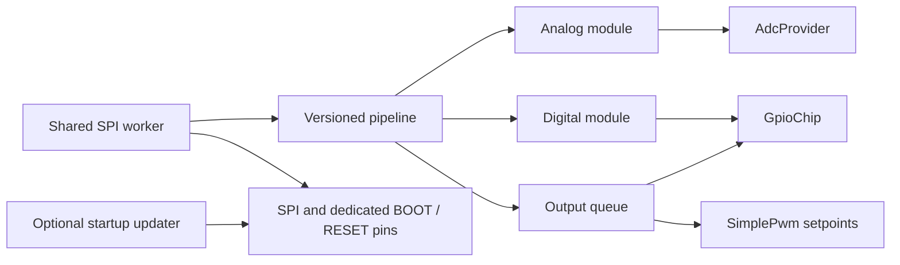

Atlas enables G0 expansion support and bundles its companion firmware by default.
Set `G0_EXTENSION=no` for hardware without the expansion. The integration targets
the version 8,
36-byte SPI application protocol from dynfer/g0-extension commit `19f0c4c`.
The protocol header preserves the wire layout. The I/O modules can also run with
`G0_FIRMWARE_UPDATE=no`, which removes the companion image and its build dependency.

The integration is split into six ordered parts:

| Part | Responsibility | Existing fome-fw interface |
| --- | --- | --- |
| 1 | Wire format, response validation, pipeline, reconnect, fair scheduling | Standalone C++ and host tests |
| 2 | DMA buffers and background SPI transfers; optional Atlas wiring | `BackgroundSpiDevice` |
| 3 | Twelve analog inputs; 250 ms expiry and recovery | `AdcProvider` |
| 4 | Four digital inputs; acknowledged mode configuration | `GpioChip` |
| 5 | Four static lowsides and local 1..500 Hz PWM | `GpioChip`, `SimplePwm` |
| 6 | Automatic image bundling, startup firmware programming and readback | STM32 ROM bootloader |



Only the worker accesses the link. The production adapters protect state with
short critical sections; no SPI operation occurs in a critical section. Modules
must be registered before starting the worker. The slave returns the preceding
request's response, so the first unsolicited frame is discarded. A response must
match its command, exact payload length, status, result, and indexed channel.
Version mismatches, invalid frames, and worker stalls trigger resynchronization.
The scheduler rotates between modules and between output channels.

Atlas owns the board mapping: SPI5, PF7/PF8/PF9 for SCK/MISO/MOSI and PF6 for CS.
The optional updater additionally owns PB14/PB15 for RESET/BOOT. Other boards can
call `g0::start` with their own SPI configuration and register the modules they
need; `service.cpp` contains no Atlas pin mapping. Do not enable this build option
for another board without supplying its `initG0Extension` implementation.

The twelve ADC slots are `EFI_ADC_20` through `EFI_ADC_31`, corresponding to G0 ADC
channels 0..9, 17, 18, in that order. The provider returns volts at the G0 MCU pin;
fome-fw's normal board divider calibration still applies. Digital pins are
`G0_DIGITAL_1` through `G0_DIGITAL_4`, and outputs are `G0_OUT_1` through
`G0_OUT_4`. These enum values occupy previously unused slots 215..222, without
reusing protected GPIO identifiers. Connector names are present in the Atlas
pin list; they require an extension-enabled firmware build to operate.

Analog values return NaN until ready or after 250 ms without a valid sample.
The ADC subscription path invalidates such readings and reinitializes its filter
on recovery. Digital reads return false when unavailable, matching the existing
boolean GPIO interface. All four digital inputs initially use ordinary digital
mode. The standalone digital state supports frequency snapshots, but frequency
sensors are not registered with fome-fw in this series. SENT is excluded until
the extension decoder validates its checksum and frame length.

Outputs start disabled. Callers change desired state without performing SPI I/O.
An acknowledgement only clears a request if its channel, applied frequency, and
duty match the sent state and no newer desired state superseded it. Outputs are
refreshed every second and reasserted after reconnect. PWM frequency is selected
when starting `SimplePwm`; duty updates and inversion are supported. Deinitializing
the output pin disables the remote output. This interface is for asynchronous
auxiliary loads: the 10 ms shared worker tick gives roughly 20..30 ms between
sensor polls once configured, and remote edges cannot follow an ECU trigger.

Build Atlas using its normal script:

```sh
cd firmware/config/boards/atlas
bash ./compile_atlas.sh
```

The updater defaults to enabled whenever G0 support is enabled. Every normal
Atlas build initializes the pinned `firmware/ext/g0_firmware` submodule, including
its ChibiOS dependency, and builds it with fome-fw's selected ARM compiler.
The build generates `firmware/generated/g0_firmware_image.h` from that binary and
reads the application version from the pinned SPI implementation. This header is
included by the updater, so the complete image becomes immutable data in the ECU
firmware's flash, just as the wideband image is bundled with its updater.

The build uses the recorded submodule commits; it never updates a moving branch.
G0 objects and binaries live in `firmware/build/g0_firmware`, outside the source
submodule. After `make clean`, the next normal build recreates both the binary and
the generated header. An unchanged image preserves the header's timestamp so it
does not unnecessarily rebuild the updater. Generation replaces changed headers
atomically and rejects invalid G071 vectors or images beyond 128 KiB.

To build the normal runtime without bundling or programming a companion image:

```sh
G0_FIRMWARE_UPDATE=no bash ./compile_atlas.sh
```

To disable the expansion entirely, use `G0_EXTENSION=no`. Both options skip the
G0 image dependency; the ECU bootloader, other board configurations without G0,
simulator, and native tests do not build the companion. For custom G0 source
releases, update the pinned submodule commit and maintain the application version
expected by the host protocol.

Programming runs before the runtime device and remote GPIOs are registered;
it has no live console update command. It skips programming if the app version
matches, otherwise resets through BOOT into ROM, writes padded 256-byte blocks,
reads every block back, resets to the application, and checks the app version.
Image version must be increased with future firmware changes; two different
images labelled version 8 cannot be distinguished by the current wire protocol.

The byte-level updater follows [ST AN4286](https://www.st.com/resource/en/application_note/an4286-how-to-use-spi-protocol-in-bootloader-on-stm32-mcus-stmicroelectronics.pdf),
including byte spacing, ACK handshakes, packet checksums, and readback. It requires
working G071 ROM SPI boot support and BOOT option bytes configured for the board.

Run the host protocol and image-generator suites with sanitizers:

```sh
cmake -S firmware/hw_layer/g0_extension/tests -B /tmp/g0-tests -DG0_SANITIZE=ON
cmake --build /tmp/g0-tests -j12
ASAN_OPTIONS=detect_leaks=0 ctest --test-dir /tmp/g0-tests --output-on-failure
```

Seven suites cover protocol validation, version/pipeline/reconnect behavior,
fair scheduling and stale in-flight replies, analog freshness and timestamp
wraparound, digital configuration, output updates during in-flight ACKs, and
scripted ROM programming including padding, readback corruption, NACK, and timeout.
Five additional Python tests cover version extraction, unchanged-header timestamps,
image replacement, invalid inputs, and disabled build dependencies. Leak detection
is disabled in the example because LeakSanitizer cannot run under ptrace;
AddressSanitizer and UndefinedBehaviorSanitizer remain enabled.

Hardware verification is still required. The current extension has no SPI-frame
CRC or transaction sequence number, and it keeps its last output setpoints when
communication stops. Host validation cannot detect every plausible bit flip or
turn off a disconnected slave. Add a slave-side command watchdog before relying
on link loss to shut off a load. Also verify real SPI timing, digital capture,
PWM frequency/duty resolution, BOOT option bytes, reset wiring, and flash recovery
on the intended Atlas/expansion hardware.
